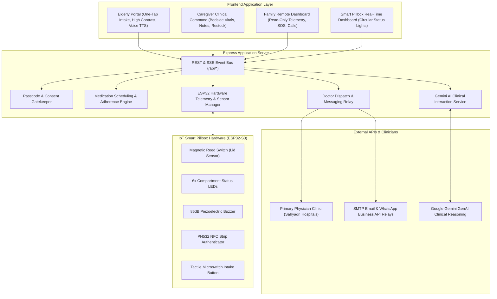
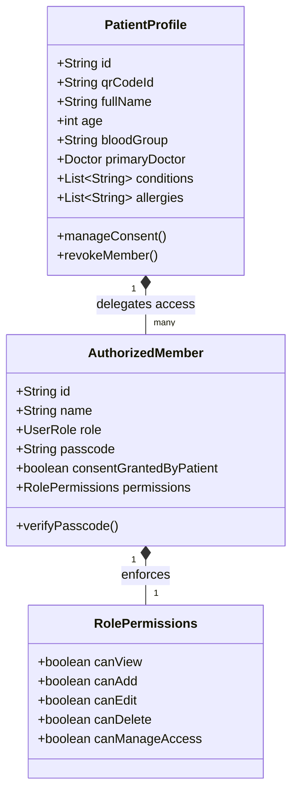
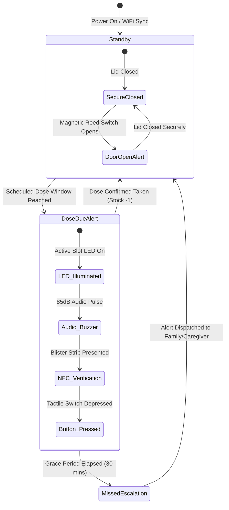
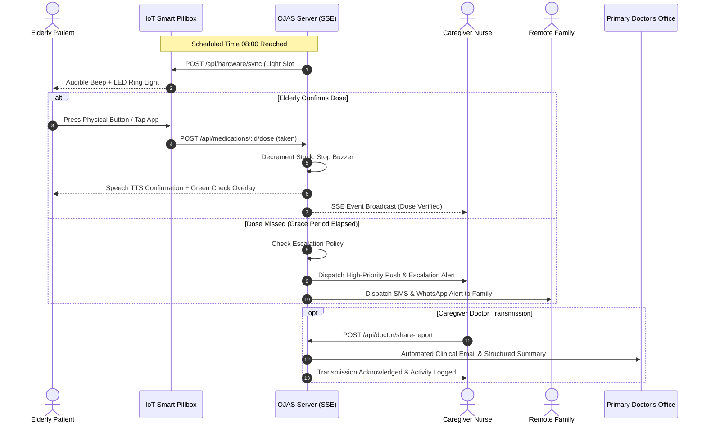
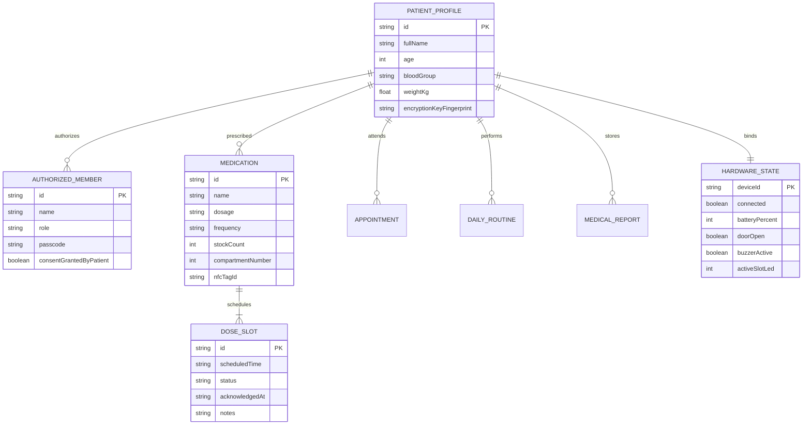

# OJAS (ओजस्) — Vital Elder Care & Smart Medication Ecosystem

[](https://ojas-catalyst26.vercel.app/)
[](https://github.com/yashkoparde/ojas)
[](https://ojas-catalyst26.vercel.app/)

> **Live Deployment:** [https://ojas-catalyst26.vercel.app/](https://ojas-catalyst26.vercel.app/)  
> **Source Code:** [https://github.com/yashkoparde/ojas](https://github.com/yashkoparde/ojas)

---

## Executive Summary

OJAS is an intelligent, interconnected healthcare platform designed to solve the critical challenges of medication non-adherence, clinical isolation, and fragmented routine monitoring among elderly individuals. By bridging the physical-digital divide through an Internet of Things (IoT) Smart Pillbox, Google Gemini AI clinical reasoning, and a sovereign multi-persona collaborative framework, OJAS transforms routine eldercare into a proactive, accessible, and dignified experience.

---

## 1. Problem Statement & Clinical Context

### The Challenge of Aging in Place
Elderly individuals managing multiple chronic conditions (polypharmacy) face severe cognitive, physical, and sensory hurdles:
- **Complex Medication Regimens**: A typical geriatric patient takes between 5 to 12 distinct medications daily across disparate time slots (fasting, post-breakfast, pre-lunch, bedtime). Complex schedules lead to unintentional double dosing, omission of critical doses, and hazardous drug-drug contraindications.
- **Physical and Cognitive Sensory Decline**: Visual impairment compromises reading fine print on blister packs; memory decline impedes recollection of whether a pill was consumed; motor stiffness makes traditional medicine bottles difficult to open.
- **Caregiver Fatigue and Information Silos**: Family members often live in separate cities or work long hours, leaving them uninformed about daily adherence until acute medical emergencies occur. Dedicated nurses and domestic caretakers lack standardized tools to record observational bedside notes and vitals.
- **Loss of Patient Dignity and Agency**: Existing reminder applications treat elderly individuals as passive recipients rather than sovereign managers of their own health, leading to resistance, non-compliance, and depression.

### Objectives of the Platform
1. **Centering the Elderly Individual**: Provide intuitive, one-tap visual and voice interfaces that preserve autonomy while eliminating technological friction.
2. **Sovereign Multi-Persona Collaboration**: Facilitate secure, passcode-governed role segregation where patients explicitly grant, manage, or revoke access permissions for family and caregivers.
3. **Hardware-Software Symbiosis**: Integrate a physical 6-compartment IoT Smart Pillbox with LED guidance, magnetic reed switch lid sensors, NFC blister verification, and audio alarms.
4. **Proactive Clinical Escalation**: Implement an automated multi-tier alerting engine that dispatches email, WhatsApp, and SMS alerts upon missed doses or vital anomalies.
5. **Direct Physician Continuity**: Allow caregivers to compile and transmit structured medication adherence and vital trend reports directly to the primary doctor's clinic.

---

## 2. System Architecture

OJAS is built on a modern full-stack architecture combining a Vite-powered React 19 single-page client, an Express server with Server-Sent Events (SSE) for real-time telemetry streaming, and server-side Google Gemini 2.5 Flash API integration.



---

## 3. Multi-Persona Sovereignty & Access Control (RBAC)

OJAS avoids the common pitfall of infantalizing the elderly by establishing strict patient sovereignty. The elderly patient owns the master health identity. Caregivers and remote family members can only access data and perform authorized clinical actions through validated 4-digit PIN authentication.



### Granular Persona Matrices

1. **Elderly Patient (Smt. Kamala Deshmukh)**:
   - Rights: One-tap dose confirmation, emergency SOS dispatch, language switching, high-contrast toggle, consent granting/revocation.
   - Guardrails: Clinical prescription modifications are locked to prevent accidental dosing errors.

2. **Primary On-Site Caregiver (Sister Priya Sharma, RN)**:
   - Rights: Verify physical dose intake, record bedside vitals (BP, glucose, SpO2), log clinical observational notes, batch restock pillbox, transmit doctor reports.
   - Authentication: 4-digit numeric PIN verified against backend hash before administrative views unlock.

3. **Remote Family Member (Rohan Deshmukh)**:
   - Rights: Real-time adherence monitoring, 1-tap direct phone call to patient/caregiver, emergency alert reception, read-only medical reports.
   - Guardrails: Cannot remotely mark physical pills as consumed unless physically on site.

---

## 4. IoT Smart Pillbox Hardware Integration

The platform includes a real-time hardware status dashboard built with a circular indicator light style user interface. It simulates an ESP32-S3 microcontroller node communicating bidirectionally with the server.



### Hardware Specifications & Telemetry Metrics

- **Circular Indicator Light Gauges**:
  - **Network Link**: Concentric pulsating emerald ring indicating active 2.4 GHz 802.11 b/g/n link (-52 dBm, 18ms latency).
  - **Power Subsystem**: Radial circular meter tracking 3.7V 2500mAh Lithium-Ion battery reserve (95% nominal).
  - **Lid Sensor**: High-visibility circular indicator glowing solid emerald when closed, and pulsing amber when the magnetic reed switch detects an open door.
  - **Piezo Alarm**: Circular alert ring displaying 85dB active buzzer alerts during dose intake windows.
- **6-Slot LED Status Ring**: Discrete circular indicator LEDs for each physical medicine compartment. Illuminating an LED immediately guides the elderly user to the correct medicine slot without confusion.

---

## 5. Proactive Notification, Escalation & Doctor Relay

A missed dose triggers an automated multi-tier escalation flow. OJAS also allows on-site caregivers to transmit structured clinical summaries directly to the primary doctor's office.



---

## 6. Healthcare Domain Data Architecture



---

## 7. Key Features & Clinical Innovations

### 1. Subtle Confirmation Animation & Caregiver Observational Notes
- **Visual Feedback for Elderly**: Marking a dose as taken triggers a spring-animated emerald overlay featuring a centered checkmark and confirmation badge, preventing anxiety and repetitive button clicking.
- **Observational Notes Field**: Caregivers can append qualitative clinical notes to any dose slot (for example, "Taken post-breakfast with warm water; blood pressure 124/80; patient rested comfortably") with one-tap preset tags.

### 2. Longitudinal 7-Day Vitals Trend Visualizer
- Visualizes systolic/diastolic blood pressure and fasting blood glucose curves over a 7-day period.
- Directly correlates regular medication compliance with physiological stability.

### 3. One-Tap Elderly Voice Input (Speech-to-Text)
- Elderly users can confirm medications by pressing the microphone icon and speaking natural phrases such as "Maine goli le li" or "Confirm morning dose", supported by Web Speech API recognition.

### 4. Direct Physician Reporting Suite
- Caregivers can generate and transmit an encrypted summary directly to Dr. Rajesh Kulkarni's office at Sahyadri Super Speciality Hospital, encompassing adherence percentages, vital logs, and observational remarks.

### 5. First-Responder Emergency QR Health Pass
- A high-visibility emergency badge modal provides immediate access to blood group, chronic illnesses, critical allergies, and direct physician telephone lines without requiring authentication.

### 6. AI Clinical Assistant (Google Gemini 2.5 Flash)
- **Drug-Drug Contraindication Scanner**: Analyzes the active medication regimen against candidate prescriptions to detect interactions, duplicate therapeutic classes, and food timing restrictions.
- **Weekly Longitudinal Summaries**: Synthesizes complex adherence logs into actionable insights for visiting physicians.

---

## 8. Expected Impact & Outcomes

| Dimension | Traditional ElderCare | OJAS Impact |
| :--- | :--- | :--- |
| **Medication Adherence** | 50% - 65% average geriatric adherence | Targeted 95%+ adherence via multi-modal sensory cues and physical pillbox sync |
| **Emergency Hospitalizations** | High incidence due to drug contraindications and missed hypertensive doses | Preventative detection via Gemini AI and proactive escalation loops |
| **Caregiver Stress Index** | High anxiety and constant manual telephone check-ins | Real-time visibility, automated notifications, and shift handover records |
| **Elderly Psychological Agency** | Feeling monitored and stripped of independence | Autonomous one-tap portal, multi-language speech, and sovereign consent |
| **Physician Visit Efficiency** | Vague recollections of symptom timelines | Objective 7-day vitals trends and timestamped caregiver observational notes |

---

## 9. How to Run Locally

### Prerequisites
- Node.js (v18.0.0 or higher)
- npm or bun package manager
- Google Gemini API Key (optional for offline testing, required for live AI interactions)

### Installation Steps

1. **Clone the Repository**:
   ```bash
   git clone https://github.com/yashkoparde/ojas.git
   cd ojas
   ```

2. **Install Dependencies**:
   ```bash
   npm install --legacy-peer-deps
   ```

3. **Configure Environment Variables**:
   Create a `.env` file in the root directory based on `.env.example`:
   ```env
   PORT=3000
   GEMINI_API_KEY=your_google_gemini_api_key_here
   ```

4. **Start the Integrated Development Server**:
   ```bash
   npm run dev
   ```
   The platform will launch concurrently on `http://localhost:3000`, serving the Express backend and the Vite React frontend.

5. **Execute Verification Checks**:
   ```bash
   # Run automated test suite (75 tests across clinical adherence, RBAC, vitals, IoT telemetry, i18n, emergency & serverless API)
   npm test

   # Verify TypeScript strict type compilation
   npm run lint

   # Execute production bundle build
   npm run build
   ```

---

## 10. API Reference Summary

| Endpoint | Method | Role Restriction | Description |
| :--- | :---: | :---: | :--- |
| `/api/state` | GET | All | Retrieve complete healthcare state snapshot |
| `/api/events` | GET | All | Real-time Server-Sent Events (SSE) telemetry stream |
| `/api/auth/verify-passcode` | POST | All | Validate 4-digit numeric PIN for role elevation |
| `/api/medications/:id/dose` | POST | Elderly, Caretaker | Mark dose status (taken, missed, skipped) with optional notes |
| `/api/medications/:id/dose/notes` | POST | Caretaker | Update observational clinical notes for a dose slot |
| `/api/hardware/sync` | POST | Elderly, Caretaker | ESP32 hardware telemetry sync (alarm, button, door toggle) |
| `/api/doctor/share-report` | POST | Caretaker | Transmit structured clinical report directly to physician's office |
| `/api/notifications/whatsapp-dispatch` | POST | Caretaker | Dispatch simulated WhatsApp/SMS alerts to Care Circle |
| `/api/ai/interaction-check` | POST | All | Evaluate medication regimen for contraindications via Gemini AI |
| `/api/sos` | POST | All | Trigger emergency broadcast to primary doctor and family contacts |
